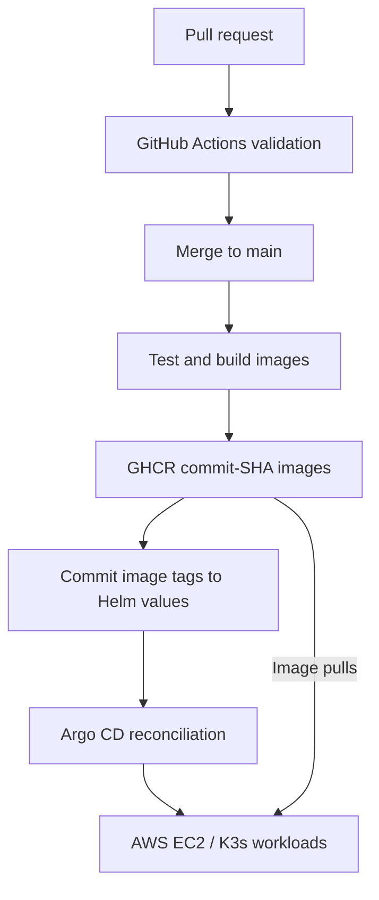
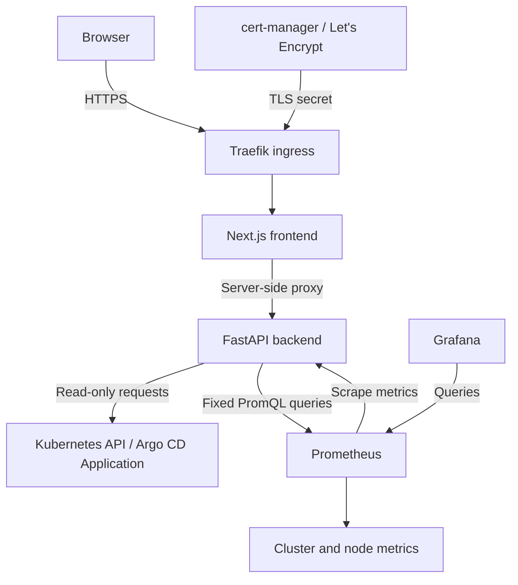

<p align="center">
  
</p>

<h1 align="center">GitOps Deployment Dashboard</h1>

<p align="center">
  <strong>From a Git commit to a running application on AWS.</strong><br />
  A read-only dashboard for deployment health, Kubernetes workloads, and application metrics.
</p>

<p align="center">
  <a href="https://gitops.3.108.53.79.sslip.io">Live demo</a> ·
  <a href="https://github.com/Chirag-Deviputra/Azure-Gitops-Deployment-Dashboard/actions">CI/CD runs</a> ·
  <a href="#architecture">Architecture</a> ·
  <a href="#development-and-validation">Development</a>
</p>

<p align="center">
  <a href="https://github.com/Chirag-Deviputra/Azure-Gitops-Deployment-Dashboard/actions/workflows/ci.yml"></a>
  
  
  
  
  
</p>

## Overview

This project demonstrates a complete GitOps delivery workflow: validate application changes, publish container images, update the desired versions in Git, and let Argo CD reconcile Kubernetes with that configuration.

The Next.js/React frontend presents live data from a FastAPI backend. The backend reads Argo CD application state, Kubernetes workloads, and Prometheus measurements using restricted access. Grafana provides deeper infrastructure and workload analysis.

Originally developed on a local **kind** cluster, the application is now deployed on **AWS EC2 running K3s**, with Traefik ingress and HTTPS managed by cert-manager and Let's Encrypt. The repository retains its original `Azure-Gitops-Deployment-Dashboard` name; the demonstrated cloud deployment is on AWS.

> **Deployment snapshot — 16 October 2026:** Argo CD reported `Synced / Healthy`, both application pods were ready with zero restarts, and the monitoring stack had running pods and bound persistent volumes. This is a development/portfolio deployment on one EC2 instance, not a highly available production service.

## Live demo

**[Open the GitOps dashboard →](https://gitops.3.108.53.79.sslip.io)**

| Resource | Link or access method |
|---|---|
| Application | https://gitops.3.108.53.79.sslip.io |
| Source code | [GitHub repository](https://github.com/Chirag-Deviputra/Azure-Gitops-Deployment-Dashboard) |
| Delivery pipeline | [Test and release](https://github.com/Chirag-Deviputra/Azure-Gitops-Deployment-Dashboard/actions/workflows/ci.yml) |
| Grafana | Private access through an SSH tunnel and Kubernetes port-forward |
| Argo CD | Administrative access through a private connection/port-forward |

The demo uses an IP-based `sslip.io` hostname. Availability depends on the EC2 instance running. If its public IP changes, the hostname, ingress configuration, certificate, and demo links need updating.

## Features

- **Deployment visibility:** Argo CD health, sync state, Git revision, and successful synchronization history.
- **Workload visibility:** desired replicas, pod readiness, container states, restarts, and terminating pods.
- **Image traceability:** desired image tags and runtime image IDs.
- **Application metrics:** request rate, p95 response latency, and HTTP 5xx error percentage.
- **Resource metrics:** frontend and backend CPU usage and memory working sets.
- **GitOps delivery:** tested commit-SHA images promoted through Helm values in Git.
- **Secure transport:** HTTPS ingress with a certificate issued through cert-manager.
- **Read-only operations:** restricted Kubernetes permissions and no dashboard mutation endpoints.
- **Persistent monitoring:** Prometheus and Grafana volumes using K3s local-path storage.

## Architecture

### Release and reconciliation



### Application and observability



The diagrams describe delivery and runtime relationships. The animated banner above is an illustrative pipeline, not a live status indicator.

## Technology stack

| Layer | Technology |
|---|---|
| Frontend | Next.js, React, TypeScript, Tailwind CSS |
| Backend | Python, FastAPI, HTTPX |
| Validation and releases | GitHub Actions |
| Container builds and registry | Docker Buildx, GitHub Container Registry |
| Cloud host | AWS EC2, Ubuntu |
| Kubernetes | K3s on AWS; kind for local development |
| Packaging and reconciliation | Helm, Argo CD |
| Ingress and certificates | Traefik, cert-manager, Let's Encrypt |
| Observability | Prometheus, kube-state-metrics, node-exporter, Grafana |
| Persistent storage | K3s local-path StorageClass |

## CI/CD workflow

The repository uses one workflow: [`.github/workflows/ci.yml`](.github/workflows/ci.yml), named **Test and release**.

| Stage | What it does |
|---|---|
| Frontend | Installs dependencies, runs lint, type checking, and tests including a production build |
| Backend | Installs Python dependencies and runs pytest |
| Manifests | Lints Helm and renders the default chart plus monitoring/ingress configuration |
| Images | Builds frontend and backend images after validation passes |
| Publish | Publishes full commit-SHA and `dev` tags for qualifying runs on `main` |
| Promote | Commits tested image tags into `helm/gitops-dashboard/values.yaml` |
| Reconcile | Argo CD detects the Git change and rolls out the desired versions |

Pull requests validate and build images without publishing or promoting them. After merge, the `main` workflow publishes images and updates Git. Promotion skips an older build if `main` has advanced; a conflicting push fails without forcing it. Repository rules must permit the intended promotion policy.

Kubernetes deploys the SHA tags recorded in Helm values. The mutable `dev` tag is also published but is not the version used by the promotion step.

## AWS deployment configuration

The working cloud environment uses these settings:

| Setting | Deployed value |
|---|---|
| AWS region | Mumbai (`ap-south-1`) |
| Cluster | Single-node K3s on EC2 |
| Application namespace | `gitops-dev` |
| Argo CD Application | `argocd/gitops-dashboard` |
| Source | `main`, path `helm/gitops-dashboard` |
| Replicas | One frontend and one backend |
| Ingress class | `traefik` |
| Host | `gitops.3.108.53.79.sslip.io` |
| TLS secret | `gitops-dashboard-tls` |
| Monitoring release / namespace | `monitoring` / `monitoring` |
| Automated sync | Enabled, with self-healing |
| Automated pruning | Disabled in the deployed AWS Application |

**Repository defaults differ from the deployed AWS overrides.** The chart defaults to two replicas and disabled ingress/monitoring. The checked-in Argo CD Application uses project `gitops-dashboard` and enables pruning; the AWS Application was created in project `default` with pruning disabled. Preserve the intended environment configuration when reconciling these files.

The AWS Helm overrides correspond to:

```yaml
frontend:
  replicas: 1
backend:
  replicas: 1
monitoring:
  enabled: true
ingress:
  enabled: true
  className: traefik
  host: gitops.3.108.53.79.sslip.io
  tlsSecretName: gitops-dashboard-tls
```

These are application settings, not a complete cluster bootstrap. K3s, Argo CD, monitoring CRDs, cert-manager, the certificate issuer, and cross-namespace RBAC must already be configured. A separate deployment needs its own hostname and certificate.

### Verify the existing AWS environment

Run on the EC2 host:

```bash
sudo k3s kubectl get nodes
sudo k3s kubectl get application gitops-dashboard -n argocd
sudo k3s kubectl get pods -n gitops-dev
sudo k3s kubectl get ingress,certificate -n gitops-dev
sudo k3s kubectl get pods,pvc -n monitoring
sudo k3s kubectl get servicemonitor -n gitops-dev
```

Expected results: a ready node, a `Synced / Healthy` Application, ready application pods, a ready TLS certificate, and bound monitoring PVCs.

## Monitoring

The monitoring stack is installed using `prometheus-community/kube-prometheus-stack` and [`monitoring/values.yaml`](monitoring/values.yaml).

| Component | Configuration |
|---|---|
| Backend ServiceMonitor | `/metrics` on named service port `http` |
| Scrape interval / timeout | 30 seconds / 10 seconds |
| ServiceMonitor selector | `release: monitoring` |
| Prometheus retention | Two days, with a 2 GB retention-size limit |
| Prometheus volume | 5 GiB, local-path storage |
| Grafana volume | 1 GiB, local-path storage |
| Alertmanager | Disabled in the development configuration |

Persistent local-path volumes survive ordinary pod replacement but remain tied to the node's storage. They do not provide off-instance backups or multi-node failover.

### Private Grafana access

On the EC2 host, keep this command running:

```bash
sudo k3s kubectl port-forward -n monitoring svc/monitoring-grafana 3002:80 --address 127.0.0.1
```

In MobaXterm, create a local SSH tunnel using your EC2 key:

| Tunnel field | Value |
|---|---|
| Local port | `3002` |
| Remote destination | `127.0.0.1` |
| Remote port | `3002` |
| SSH server | Your EC2 public IP |
| SSH username | `ubuntu` |
| SSH port | `22` |

Start the tunnel and visit **http://localhost:3002**. The browser address works only while both the tunnel and port-forward are active. Use the credentials belonging to this Grafana installation.

## API and security model

| Backend endpoint | Purpose |
|---|---|
| `GET /health` | Liveness probe |
| `GET /ready` | Readiness probe |
| `GET /metrics` | Prometheus exposition |
| `GET /api/applications` | Argo CD and workload state |
| `GET /api/metrics` | Aggregated monitoring measurements |

The browser uses same-origin frontend API routes. The backend communicates with Kubernetes through the `gitops-dashboard-backend` service account.

- Namespaced RBAC permits reads of the named frontend/backend Deployments and listing pods in the workload namespace.
- A separate Role and RoleBinding in `argocd` permit `get` on the named `gitops-dashboard` Application.
- Pod filtering happens in application queries; namespace-level pod-list permission is not restricted to individual pod names by RBAC.
- The dashboard provides no resource mutation, synchronization, deletion, or rollback API.
- PromQL expressions are controlled by the server, and missing samples are represented as unavailable values.
- HTTPS protects traffic in transit; it does not itself provide user authentication. Identity-aware access remains a future improvement.

## Repository guide

| Path | Purpose |
|---|---|
| `app/` | Dashboard pages and server-side API routes |
| `components/` | Shared UI components |
| `backend/app/` | FastAPI application and monitoring integration |
| `backend/tests/` | Backend automated tests |
| `tests/` | Frontend/build tests |
| `.github/workflows/ci.yml` | Unified validation and release workflow |
| `helm/gitops-dashboard/` | Helm chart and desired image versions |
| `argocd/` | Application and project definitions |
| `monitoring/` | Monitoring values and supporting definitions |
| `scripts/` | Build verification and image promotion scripts |
| `docs/` | Architecture, preparation notes, and visual assets |
| `Dockerfile` | Frontend container build |
| `backend/Dockerfile` | Backend container build |
| `Start-GitOps.bat` | Existing local kind environment launcher |

## Development and validation

Clone the repository:

```bash
git clone https://github.com/Chirag-Deviputra/Azure-Gitops-Deployment-Dashboard.git
cd Azure-Gitops-Deployment-Dashboard
```

Use Node.js 22 (at least 22.13), Python 3.13, Docker, and Helm. The following commands target Linux or WSL because the npm scripts use Bash.

### Frontend

```bash
npm ci
npm run lint
npm run typecheck
npm test
```

`npm test` includes the verified production build and Node.js tests. For container validation:

```bash
docker build -t gitops-dashboard-frontend:check .
```

### Backend

```bash
python3 -m venv .venv
source .venv/bin/activate
pip install -r backend/requirements.txt
PYTHONPATH=backend python -m pytest backend/tests
```

### Helm

```bash
helm lint helm/gitops-dashboard
helm template gitops-dashboard helm/gitops-dashboard --namespace gitops-dev
helm template gitops-dashboard helm/gitops-dashboard \
  --namespace gitops-dev \
  --set monitoring.enabled=true \
  --set ingress.enabled=true \
  --set ingress.className=traefik \
  --set ingress.host=dashboard.example.com \
  --set ingress.tlsSecretName=dashboard-tls
```

Rendering validates templates without deploying resources. A working application requires the Kubernetes, Argo CD, and monitoring integrations described above.

### Existing local kind environment

The original Windows development environment remains useful for local testing. With Docker Desktop running and the `kind-gitops-dev` cluster already configured, start the launcher:

```powershell
.\Start-GitOps.bat
```

Typical local ports are dashboard `3001`, backend `8001`, Argo CD `8080`, Grafana `3002`, and Prometheus `9090`. Avoid reusing a local port already occupied by an AWS SSH tunnel.

## Troubleshooting

| Symptom | First checks |
|---|---|
| Argo CD is OutOfSync | Inspect the differing resources and desired Helm values before syncing or pruning |
| Pod is not ready | Describe the pod, inspect events, then check container logs |
| ImagePullBackOff | Verify the GHCR image/tag and access permissions |
| Metrics unavailable | Check the ServiceMonitor label, Prometheus target health, and backend logs; allow time for new samples |
| Grafana PVC Pending | Check the requested StorageClass and available node disk space |
| Grafana unavailable locally | Verify both port-forward and SSH tunnel are running and local port 3002 is free |
| HTTPS endpoint unavailable | Check DNS/public IP, EC2 networking, Traefik, ingress host, and certificate readiness |

Useful read-only diagnostics on EC2:

```bash
sudo k3s kubectl get events -n gitops-dev --sort-by=.lastTimestamp
sudo k3s kubectl logs deployment/gitops-dashboard-frontend -n gitops-dev --tail=60
sudo k3s kubectl logs deployment/gitops-dashboard-backend -n gitops-dev --tail=60
sudo k3s kubectl describe certificate gitops-dashboard-tls -n gitops-dev
```

## Milestones and next steps

- [x] Local kind deployment and Kubernetes troubleshooting
- [x] Frontend/backend validation and container builds
- [x] GHCR publishing with commit-SHA tags
- [x] Automated image promotion through Git
- [x] AWS EC2 deployment with K3s and Argo CD
- [x] HTTPS ingress and certificate issuance
- [x] Read-only application and workload visibility
- [x] Prometheus metrics and Grafana access
- [x] Persistent monitoring volumes
- [ ] Commit the complete AWS bootstrap and environment overrides to Git
- [ ] Establish a stable public address and a custom domain
- [ ] Add identity-aware access for shared use
- [ ] Configure alert notification delivery
- [ ] Add backups and document restore procedures
- [ ] Pin and document infrastructure/chart versions for reproducible rebuilds
- [ ] Automate AWS infrastructure provisioning

## Author

Built by **[Chirag Deviputra](https://github.com/Chirag-Deviputra)** to demonstrate CI/CD, containers, Kubernetes, GitOps, cloud deployment, RBAC, and observability through a working application.

---

<p align="center">
  <strong>Commit → Validate → Publish → Reconcile → Observe</strong><br />
  <a href="https://gitops.3.108.53.79.sslip.io">Explore the live dashboard</a>
</p>
